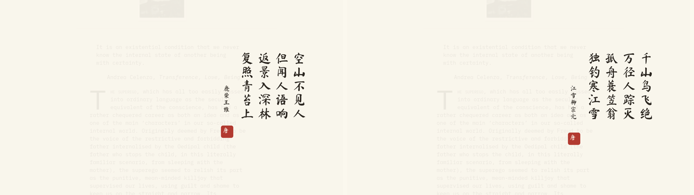

# Tang Calligraphy — an Omarchy theme

Ink on rice paper. A light Omarchy theme of warm paper tones, ink-black
text, and a cinnabar seal-red accent, with desktop backgrounds that carry
Tang dynasty poems in vertical calligraphy.



## Install

Two steps — first download the theme, then activate it:

```bash
# 1. Download the theme into Omarchy (~/.config/omarchy/themes/tang-calligraphy)
omarchy theme install https://github.com/paulofrank/omarchy-tang-calligraphy-theme

# 2. Apply it: regenerates your terminal, editor and desktop configs
#    from the theme's palette and switches to its paper background
omarchy theme set tang-calligraphy
```

The theme ships seven backgrounds: one plain paper and six Tang poems.
Cycle through them with `omarchy theme bg next`, or pick one visually
with `omarchy theme bg switcher`. Switch back to your previous theme
any time with `omarchy theme set <name>`.

## Backgrounds

Seven variants, all built from the same rice-paper base:

- `01-paper.png` — plain paper texture
- `02-luchai.png` — 鹿柴 · 王維 (Wang Wei)
- `03-jingyesi.png` — 靜夜思 · 李白 (Li Bai)
- `04-chunxiao.png` — 春曉 · 孟浩然 (Meng Haoran)
- `05-jiangxue.png` — 江雪 · 柳宗元 (Liu Zongyuan)
- `06-guanquelou.png` — 登鸛雀樓 · 王之渙 (Wang Zhihuan)
- `07-jueju.png` — 絕句 · 杜甫 (Du Fu)

The poems are set in traditional characters with
[AR PL UKai TW](https://www.freedesktop.org/wiki/Software/ttf-arphic-ukai/)
(文鼎楷體, a kai calligraphy face by Arphic Technology, Arphic Public
License; the TW face is included in `fonts/`, license text in
`fonts/ARPHIC-PUBLIC-LICENSE.txt`), in vertical columns read right to
left, with a cinnabar 唐 seal.

Regenerate the backgrounds with:

```bash
python3 bin/render-backgrounds.py
```

Requires ImageMagick.

## Palette

| Role | Colour | |
|---|---|---|
| background | `#FAF6EB` | rice paper |
| foreground | `#2B2620` | ink |
| accent | `#B23A30` | cinnabar / seal red |
| selection | `#E8E0CC` | aged paper |
| muted | `#A89C84` | faded ink |

## Compatibility

The theme is intentionally minimal — `colors.toml` plus backgrounds — so
Omarchy regenerates every application's config (terminal, Hyprland,
Neovim, VS Code…) from the palette through its own templates. That is the
mechanism designed to keep themes working across Omarchy versions. Tested
on Omarchy 3.x (October 2026); please open an issue if a future update
breaks anything.

## Credits

- Poems: Tang dynasty, public domain.
- Font: AR PL UKai TW by Arphic Technology Co., Arphic Public License
  (see `fonts/ARPHIC-PUBLIC-LICENSE.txt`).
- Theme: MIT (see `LICENSE`).
